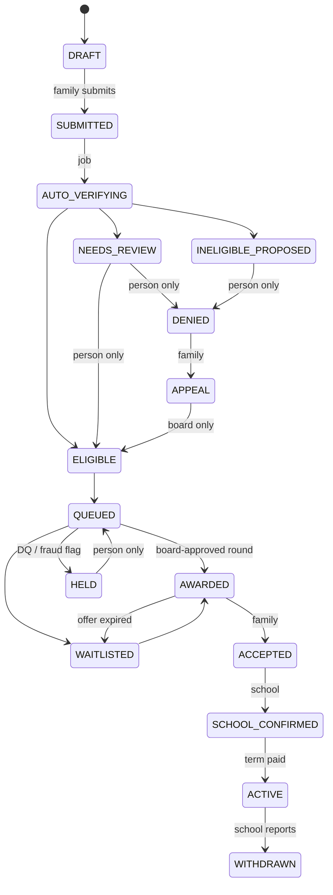

# Architecture

## Components

| Layer | Choice | Why |
|---|---|---|
| Web app | Next.js 15 (App Router, server actions) on Vercel | One codebase for public site and four portals |
| Data, auth, files | Supabase: Postgres + row-level security, email-link auth, private storage bucket | RLS keeps each household/school/donor to its own rows; storage holds tax documents |
| Rules | `src/domain` (pure TypeScript) | Same code in the app, jobs, tests and the prototype |
| Jobs | Trigger.dev v4 | Durable, retried, scheduled tasks with logs |
| Donations | Stripe Checkout (card, Apple Pay, Google Pay; setup mode for pledges) | Nonprofit pricing; wallets included |
| School payments | `PAYOUT_PROVIDER`: manual CSV for the bank portal, or Increase ACH API | Start manual, automate when volume justifies it |
| AI | Claude via the Anthropic API | Document reading, review drafts, help assistant |
| Email | Resend | Magic links via Supabase; transactional mail via Resend |

## Case flows

Gifts: `PLEDGED → DESIGNATION_RECONFIRMED → CHARGED → SETTLED → DEPOSITED → RECONCILED → ACKNOWLEDGED → REPORTED` (or `FAILED`, `CHARGEBACK`, `CANCELLED`).
Schools: `UNCLAIMED → CLAIM_PENDING → DOMAIN_VERIFIED → AGREEMENT_SIGNED → PAYEE_VERIFIED → ACTIVE`.
Payment batches: `DRAFT → PREPARED → APPROVED_1 (staff or board) → APPROVED_2 (board) → SENT → SETTLED`.

## Self-correcting controls

| Control | Where | What happens on failure |
|---|---|---|
| Legal transitions only; human-only steps refuse agents/jobs | DB trigger `enforce_application_transition` | Statement fails; nothing changes |
| Balanced journals; append-only ledger and audit | DB triggers | Transaction rolls back |
| Only qualified money in the §25F fund | DB trigger + `gifts` check constraint + `routeGift` | Gift routed to the general fund |
| Processor ↔ bank ↔ ledger reconciliation; card-fee top-up | `reconcile()` hourly | Critical finding pauses disbursements |
| §25F account bank balance = ledger balance | `evaluate()` | Pauses disbursements and acknowledgments |
| 90% test forecast (FIFO, deadline Dec 31 of following year) | `ninetyPercentTest()` | Warning 1 year ahead; critical if missed |
| ≥10 students not all at one school | `evaluate()` | Warning before round approval |
| Disqualified-person screening before every award | `screen()` in `runRound` | Applicant held for board |
| Payment gates: enrollment confirmed, residency re-attested, payee verified, no recent unverified bank change, cash on hand | `buildBatch()` | Line blocked, paid in a later batch |
| Two approvers incl. a board officer | `approve_batch` RPC + batch trigger | Send refused |
| Year-end tie-out: acknowledgments = IRS report = designated deposits | `tieOut()` | Release blocked; critical ticket |
| Reused document across households | document agent | Fraud ticket; applications held |
| Offer expiry | daily job | Award returns to waitlist; money to the pool |

## Agents

| Agent | Reads | Writes | Cannot |
|---|---|---|---|
| Document agent | One uploaded document | Extracted fields (no SSN fields exist), agent log, review ticket | Decide eligibility; change state |
| Review agent | Ticket + latest determination | Recommendation text, agent log | Resolve tickets; change state |
| Support agent | FAQ; the signed-in user's own records (RLS-bound) | Agent log, handoff ticket | See anyone else's data; give tax advice |

All agent outputs are written to `agent_actions` (append-only) with model and prompt version.

## Data protection
- Donor SSNs are never collected (the IRS donor number replaces them).
- Tax documents live in a private bucket under the household's folder; raw files are deleted 3 years after decision, extracted values and hashes remain.
- Bank account numbers are tokenized by the payment provider; only last 4 digits are stored.
- MFA is required for school admins, staff and board (`profiles.mfa_required`; enforce in Supabase Auth settings).
- Security headers set in `next.config.ts`; service-role key used only in server code.
